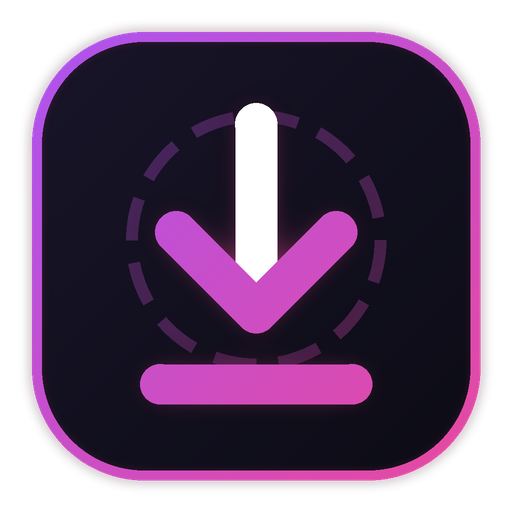
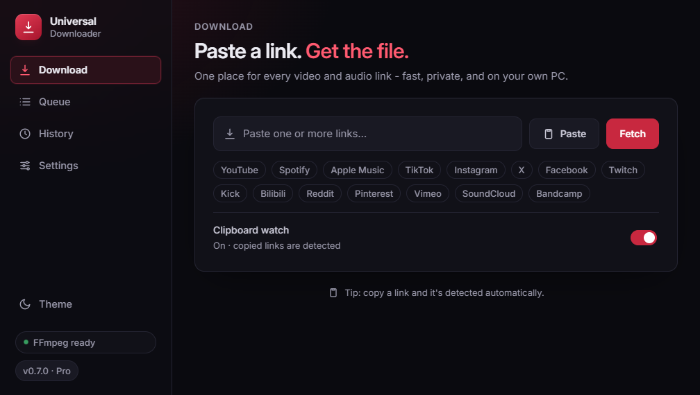
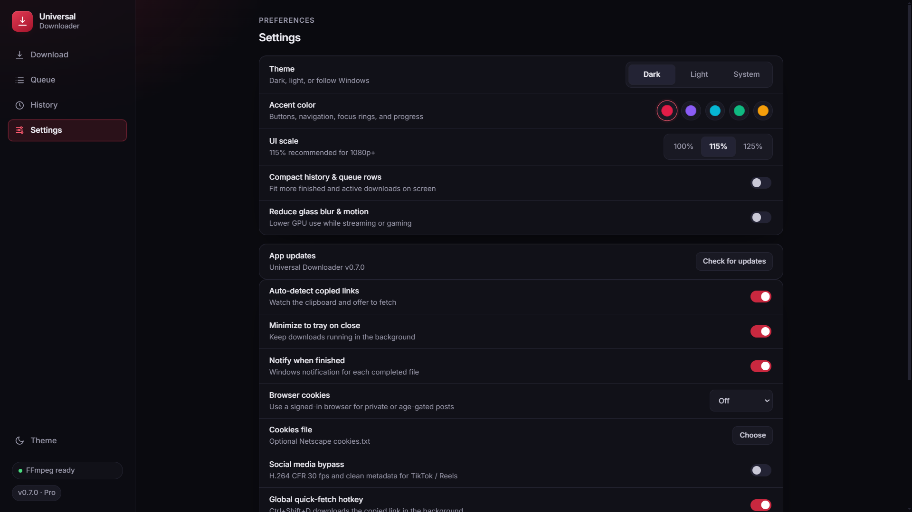
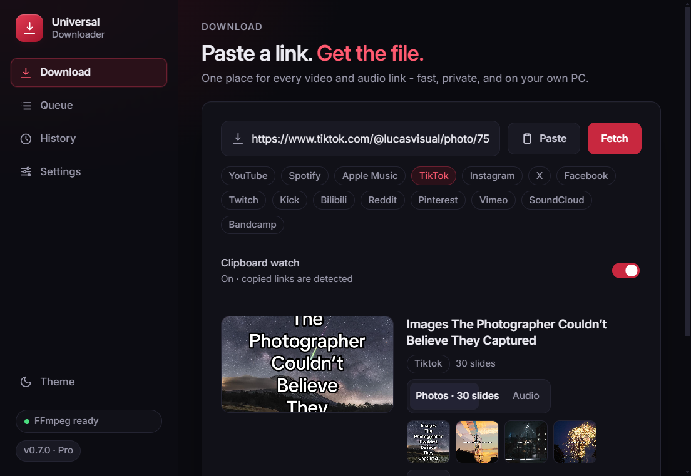
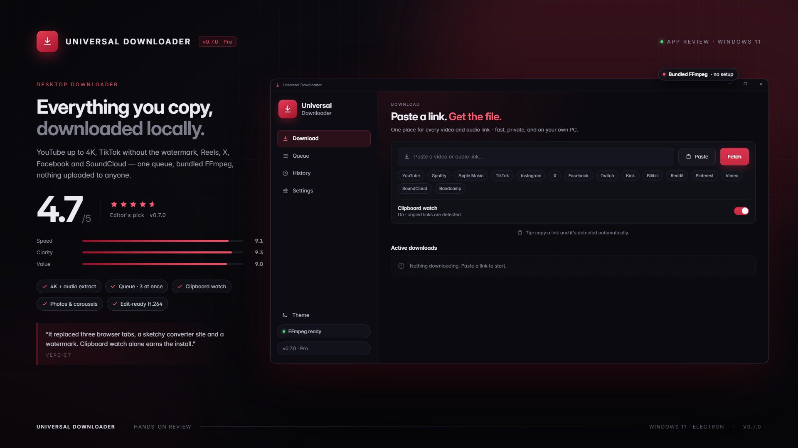

<div align="center">
  
  <h1>Universal Downloader</h1>
  <p><strong>Everything you copy, downloaded locally.</strong></p>
  <p>
    A native Windows 11 downloader for YouTube, TikTok, Instagram, Spotify, Apple Music,
    Twitch, and 10+ creator sites.<br />
    One queue. Bundled FFmpeg. No uploads. No terminal windows.
  </p>
  <p>
    
    
    
    
    
    
    
  </p>
  <p>
    <a href="https://github.com/x1Swimzft/universal-downloader/releases/latest">
      
    </a>
    <a href="#user-content--build-from-source">
      
    </a>
  </p>
</div>

> **v0.7.0** adds Spotify and Apple Music bridging, TikTok Photo Mode, an Instagram public-post fallback, playlist folders, audio filename templates, and 1–5 concurrent downloads.

---

## ✨ What's new in 0.7.0

| Area | Upgrade |
| --- | --- |
| **Music library** | Resolve public Spotify and Apple Music tracks, albums, and playlists, then download tagged audio with embedded cover art. |
| **TikTok Photo Mode** | `/photo/` posts become **Photos · N slides** carousels, saved as a ZIP, with the background music available as an optional Audio mode. |
| **Instagram fallback** | Public posts and carousels extract through Instagram's embed payload when anonymous `yt-dlp` hits a login wall. |
| **Playlist folders** | Playlists and albums save into sanitized subfolders with track-numbered filenames. |
| **Audio templates** | Name files with presets such as `{artist} - {title}` or `{track} - {artist} - {title}`. |
| **Batch control** | Multi-link previews, checklists, select all/none, and concurrent downloads (1–5, default 3). |

---

## 🖥️ Screens

| Download | Settings |
| --- | --- |
|  |  |

### TikTok Photo Mode



---

## ⭐ Hands-on review

<a href="docs/assets/review.png">
  
</a>

| Overall | Speed | Clarity | Value |
| :---: | :---: | :---: | :---: |
| **4.7 / 5** | 9.1 | 9.3 | 9.0 |

> “It replaced three browser tabs, a sketchy converter site and a watermark. Clipboard watch alone earns the install.”
>
> **Verdict** · Editor's pick · Windows 11 · v0.7.0

---

## 🚀 Why it feels different

| Feature | What it does |
| --- | --- |
| **Native desktop shell** | Electron app with tray support, single-instance lock, and no browser tabs or hidden terminal windows. |
| **Clipboard watcher** | Detects copied media links and offers to fetch them instantly. |
| **Real-time queue** | Live progress, speed, pause/resume/retry, and 1–5 concurrent downloads over SSE. |
| **Full quality pipeline** | Handles Node.js challenges through `yt-dlp`, merges video/audio, and uses bundled FFmpeg for MP4, MP3, M4A, and OPUS. |
| **Photos & carousels** | Downloads Instagram image posts and TikTok slideshows as full-size JPGs or a ZIP. |
| **Creator workflow** | Start/end clipping, H.264 edit-ready output, loudness normalization, and native drag-out to OBS, DaVinci Resolve, or CapCut. |
| **Self-healing engine** | Browser cookie import (`cookies.txt`, Chrome, Edge, Brave, Firefox) and in-app `yt-dlp` updates. |
| **Private by design** | Media is fetched directly to your PC. Nothing is uploaded to a third-party service. |

---

## 🌐 Supported sites

**Video & social**  
`YouTube` `TikTok` `Instagram` `Facebook` `X / Twitter` `Twitch` `Kick` `Bilibili` `Vimeo` `Reddit` `Pinterest`

**Music & audio**  
`Spotify` `Apple Music` `SoundCloud` `Bandcamp`

> Music links resolve public metadata and bridge to a matching audio source through `ytsearch1`. Public Instagram posts use the embed fallback when anonymous extraction is blocked.

---

## 📦 Install

### Installer (recommended)

[**Download Universal-Downloader-Setup-0.7.0.exe**](https://github.com/x1Swimzft/universal-downloader/releases/download/v0.7.0/Universal-Downloader-Setup-0.7.0.exe)
— one-click per-user install, no dependencies.

### Portable

[**Download Universal Downloader-0.7.0-win.zip**](https://github.com/x1Swimzft/universal-downloader/releases/download/v0.7.0/Universal.Downloader-0.7.0-win.zip)
— extract and run `Universal Downloader.exe` directly.

Everything needed at runtime — the Python engine, FFmpeg, and static UI — is bundled.

See the [v0.7.0 release](https://github.com/x1Swimzft/universal-downloader/releases/tag/v0.7.0)
for `latest.yml`, the `.blockmap`, and [SHA-256 checksums](https://github.com/x1Swimzft/universal-downloader/releases/download/v0.7.0/SHA256SUMS-0.7.0.txt).

---

## 🛠️ Architecture

```text
universal-downloader/
├── desktop/       Electron shell, tray, updater, drag-out, backend supervisor
├── backend/       FastAPI + yt-dlp + FFmpeg sidecar engine
├── frontend/      Next.js 14 + TypeScript + Tailwind UI
└── docs/assets/   README screenshots and review artwork
```

| Layer | Stack |
| --- | --- |
| Desktop | Electron 33.4.11, system tray, single-instance lock, electron-updater |
| Backend | Python 3.11, FastAPI, Uvicorn, APScheduler, yt-dlp |
| Frontend | Next.js 14.2.35 static export, React 18, TypeScript, Tailwind CSS |
| Media | Bundled FFmpeg Essentials, FFprobe, Node.js runtime |

---

## 💻 Build from source

### Requirements

- Windows 10/11
- Node.js 18+ (tested on Node 26)
- Python 3.11+
- FFmpeg available in `PATH`

### Backend

```powershell
cd backend
python -m venv .venv
.\.venv\Scripts\activate
pip install -r requirements.txt
python -m uvicorn app.main:app --port 8000 --host 127.0.0.1
```

### Frontend

```powershell
cd frontend
npm install
npm run dev
```

### Desktop shell

```powershell
cd desktop
npm install
npm start
```

### Package the standalone release

```powershell
# 1. Build and sync the static frontend
cd frontend
npm run build
Remove-Item ..\desktop\frontend-out -Recurse -Force -ErrorAction SilentlyContinue
Copy-Item out ..\desktop\frontend-out -Recurse

# 2. Build and sync the frozen backend
cd ..\backend
.\.venv\Scripts\pyinstaller backend-engine.spec --noconfirm --clean
Remove-Item ..\desktop\backend-engine -Recurse -Force -ErrorAction SilentlyContinue
Copy-Item dist\backend-engine ..\desktop\backend-engine -Recurse

# 3. Build the installer and portable ZIP
cd ..\desktop
npm run dist
```

Outputs land in `desktop/dist-release/`. The installer is a one-click per-user NSIS build;
the portable ZIP contains the same app with bundled runtime assets.

---

## 🔌 Headless quick-fetch API

For streamers and automation, fetch an asset directly to disk without the UI:

```http
POST /api/rio/quick-fetch
Content-Type: application/json
X-App-Token: <session token>

{
  "url": "https://www.youtube.com/watch?v=...",
  "format": "mp4",
  "quality": "1080",
  "save_to_dir": "D:\\Stream Assets"
}
```

Supports the same formats and creator sites as the desktop app.

---

## 🧪 Verification

The current release was checked with:

- `pytest` - 134 tests / 89 subtests
- `npm run build` — Next.js production build
- Packaged startup, installed startup, menu/shortcut, and updater IPC smoke tests
- Live TikTok Photo Mode extraction, ZIP download, and background-audio MP3 download
- Live public Instagram carousel fallback
- 820×620 / 125% responsive pass and a clean 1920×1080 UI capture

---

## 📄 License

Intended for personal use. Source code is licensed under the [MIT License](LICENSE).

Third-party software notices and licenses are listed in
[THIRD_PARTY_NOTICES.md](THIRD_PARTY_NOTICES.md).
